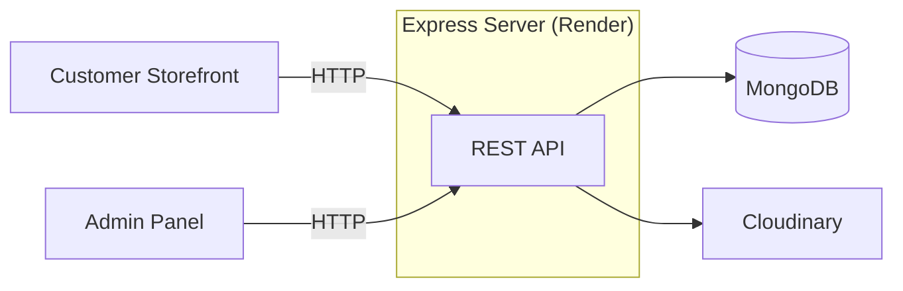

<div align="center">


# Forever

**Shop with ease. Manage with control.**

An e-commerce web app where customers browse and order products, and the shop owner manages the catalog and order fulfillment from an admin panel.

<br />


<br />

[](https://ecommerce-frontend-tpyf.onrender.com/)

<br />


</div>

---

> [!TIP]
> 🚀 **Live.** Forever is deployed on Render: **[ecommerce-frontend-tpyf.onrender.com](https://ecommerce-frontend-tpyf.onrender.com/)**
>
> <!-- VERIFY: Render free-tier services can take a short while to wake after inactivity. Remove this note if you use a paid plan. -->
> On Render's free tier, the first request after a period of inactivity may be slow while the service wakes up.

## 📖 About

Forever is an e-commerce website with two sides: a storefront where customers place orders, and an admin panel where the shop owner manages products and tracks each order through fulfillment.

The backend is a single Express server backed by MongoDB, with product images stored on Cloudinary.

## 🌐 Live Links

| App | URL |
| --- | --- |
| 🛍️ **Storefront** | [ecommerce-frontend-tpyf.onrender.com](https://ecommerce-frontend-tpyf.onrender.com/) |
| 🛠️ **Admin panel** | <!-- VERIFY: add admin URL --> _add URL_ |
| ⚙️ **API** | <!-- VERIFY: add backend URL --> _add URL_ |

## ✨ Features

### 🛍️ Customers

| Feature | Description |
| --- | --- |
| 📦 **Browse products** | View the shop's product catalog |
| 🛒 **Place orders** | Order products from the storefront |

### 🛠️ Admin / Shop owner

| Feature | Description |
| --- | --- |
| ➕ **Add products** | Create products with images uploaded to Cloudinary |
| ✏️ **Edit products** | Update product details |
| 🗑️ **Delete products** | Remove products from the catalog |
| 🚚 **Manage orders** | Update order status: **Packaging**, **Shipped**, **Delivered** |

<!-- VERIFY: add features that actually exist (cart, authentication, payments, search, etc.) and remove any that don't. -->

## 🧰 Tech Stack

| Layer | Technologies |
| --- | --- |
| **Backend** | Express.js, Node.js |
| **Database** | MongoDB |
| **Media** | Cloudinary |
| **Hosting** | Render |

<!-- VERIFY: add your frontend framework, styling library, auth, and payment provider if used. -->

## 🏗️ Architecture

Forever is a monolithic application with a single Express server.



<!-- VERIFY: confirm the storefront and admin panel are separate apps that both call the same API. -->

## 📁 Project Structure

```text
forever/
├── frontend/      # Customer storefront
├── admin/         # Admin panel
├── backend/       # Express API
├── assets/        # Logo and static README assets
└── README.md
```

<!-- VERIFY: replace with the actual folder names and layout of the repository. -->

## 🚀 Getting Started

### Prerequisites

- Node.js and npm
- A MongoDB database (local or hosted)
- A Cloudinary account

### Installation

```bash
git clone <your-repository-url>
cd forever
npm install
```

<!-- VERIFY: if each folder has its own package.json, run npm install in each one. -->

### Configuration

<!-- VERIFY: document the real environment files and variables (e.g. from .env.example). None are listed here to avoid inaccuracies. -->

Create the required environment files for MongoDB and Cloudinary, as described in the repository's example env files. Never commit secrets.

### Run locally

```bash
npm run dev
```

<!-- VERIFY: replace with the exact scripts defined in each package.json (backend, frontend, and admin may start separately). -->

## 🚢 Deployment

Forever is deployed on [Render](https://render.com/).

1. Provision a MongoDB database (for example, MongoDB Atlas).
2. Create a Render service for each app (backend, storefront, admin) pointing at this repository and the matching folder.
3. Set the build and start commands for each service.
4. Add production environment variables in Render's dashboard, including MongoDB and Cloudinary credentials.
5. Point the storefront and admin apps at the deployed API URL.

<!-- VERIFY: confirm service types (Web Service vs Static Site), build/start commands, root directories, and any CORS settings required between frontends and the API. -->

## 🗺️ Roadmap

- [x] 📦 Product browsing and ordering
- [x] ➕ Admin product management (add, edit, delete)
- [x] 🚚 Order status updates (Packaging, Shipped, Delivered)
- [x] 🚢 Deployment on Render
- [ ] 🧪 Testing and CI/CD
- [ ] 📈 Monitoring and analytics

<!-- VERIFY: adjust checkmarks and planned items to match reality. -->

## 📄 License

A license has not yet been specified for this project.

<!-- VERIFY: if a LICENSE file exists in the repository, replace this section with its name and a link. -->

---

<div align="center">

**Forever** · Shop with ease. Manage with control.

</div>
